<picture>
  <source media="(prefers-color-scheme: dark)" srcset="./art/hero-dark.svg">
  
</picture>

  

<picture>
  <source media="(prefers-color-scheme: dark)" srcset="./art/ledger-dark.svg">
  
</picture>

 

<picture>
  <source media="(prefers-color-scheme: dark)" srcset="./art/rule-career-dark.svg">
  
</picture>

I am a sophomore in Fremont, and I spend most of my time in other people's codebases. Not writing tutorials about them. Fixing them. When I'm not doing that, I design robots for my FTC team and build AI agents at hackathons.

- **132 merged pull requests** into 50 repositories across 25 organizations, including Meta, Apple, NVIDIA, OpenAI, Google and the Rust project.
- **4 hackathon wins** in 2026.
- **Lead CAD Designer and Design Captain** of FTC Team 23543, The Architects. 3x FTC Qualifier Finalist.
- **Qualified for the AIME** through the AMC 10.

#### Four hackathons, four wins

| Hackathon | Result | Build |
|:--|:--|:--|
| **Beta Fund x EverMind Super Hackathon** May 2026 | 1st place and Audience Favorite, $600 | [SwarmMarket](https://github.com/LeSingh1/swarm-market), an app store for agent experience. One weekend, one teammate. |
| **Beta Fund AI Super Hackathon** May 2026 | Winner, $500 | [ShadowBuyer](https://github.com/LeSingh1/shadowbuyer), a six-agent procurement system that negotiates with vendors. |
| **Eco Hacks** April 2026 | Winner | [EcoLens](https://github.com/LeSingh1/ewaste-detector), which looks at a photo of old electronics, estimates what they're worth, and tells you whether to sell, trade in or recycle. |
| **IHS CSDECA Hackathon** November 2026 | Winner, team of two | [ShadowBuyer for Main Street](https://github.com/LeSingh1/Deca-Hackathon-IHS), AI agents that get restaurant owners their card-processing money back, over text. |

 

<picture>
  <source media="(prefers-color-scheme: dark)" srcset="./art/rule-builds-dark.svg">
  
</picture>

<table>
<tr>
<td width="50%" valign="top">

#### [ShadowBuyer for Main Street](https://github.com/LeSingh1/Deca-Hackathon-IHS)
A restaurant owner texts a photo of their card-processing statement. Claude agents find the hidden fees, expose a "1.35 factor" cash advance as about 93% APR, and negotiate with a simulated processor rep. Nothing happens until the owner replies YES, and every dollar figure comes from unit-tested code, never the model.

</td>
<td width="50%" valign="top">

#### [SwarmMarket](https://github.com/LeSingh1/swarm-market)
Agents publish what they learned as portable skill packs, and other agents install those lessons in one call, with no retraining. A React and Vite marketplace shows live before-and-after behavior, on a Node backend built on the Claude API with an MCP server.

</td>
</tr>
<tr>
<td width="50%" valign="top">

#### [Hackathon Reverse Engineer](https://github.com/LeSingh1/hackathon-rce)
Semantic search over 1,319 winning Devpost projects from 408 hackathons, packaged as a Claude Code skill. Describe the hackathon you're entering and it pulls the closest past winners, then turns them into patterns and ideas. ChromaDB, sentence embeddings, 26 pytest tests.

</td>
<td width="50%" valign="top">

#### [nba_shot_quality](https://github.com/LeSingh1/nba_shot_quality)
A calibrated expected field goal percentage model on free playoff data. The point is the method: cross-validation grouped by game so nothing leaks between folds, target encoding inside the pipeline, a logistic-regression baseline the bigger model has to beat, and empirical-Bayes shrinkage so a player with 25 shots can't top the rankings.

</td>
</tr>
<tr>
<td width="50%" valign="top">

#### [CourtCommand](https://github.com/LeSingh1/courtcommand)
Thirty NBA analytics tools behind one natural-language command bar: shot quality, player similarity, a cap-legal trade machine, lineup optimization. Every panel computes live from ESPN data for 500+ rostered players. 158 engine unit tests and a hand-built SVG chart kit with zero charting dependencies.

</td>
<td width="50%" valign="top">

#### [ShadowBuyer](https://github.com/LeSingh1/shadowbuyer)
Six agents handle procurement from start to finish: vendor scouting, quote collection, adversarial negotiation, contract redlines and email drafting. In the demo negotiation it cut the price from $195 to $157.50 per host per month. Python, FastAPI and React.

</td>
</tr>
</table>

 

<picture>
  <source media="(prefers-color-scheme: dark)" srcset="./art/rule-merges-dark.svg">
  
</picture>

**132 merges. 25 organizations. 50 repositories.** I sent every one cold: no referral, no internship, nobody who knew my name first.

The pitch is narrow on purpose. I find a real bug in a library you already depend on, write the regression test that fails before and passes after, and send it in.

<table>
<tr>
<td width="50%" valign="top">

#### The one I am proudest of

[**pyrefly#3415**](https://github.com/pyrefly-org/pyrefly/pull/3415) fixes negative narrowing for `isinstance` checks against a tuple of classes, in Pyrefly, the Python type checker from Meta. Meta imported it through Phabricator and landed it as [`92413ec`](https://github.com/pyrefly-org/pyrefly/commit/92413ec83a599d50cd2aa1dfd8e94a22ba8a56a9). The mypy_primer bot ran it against 9 real open-source projects and classified the change as 5 improvements and 4 neutral.

</td>
<td width="50%" valign="top">

#### The longest one

NVIDIA's maintainer opened [cuda-python#2410](https://github.com/NVIDIA/cuda-python/issues/2410) to move the project from `os.path` to `pathlib`. I volunteered, counted 222 `os.path` call sites across 41 files, and proposed splitting the work into seven reviewable parts. Along the way I flagged that `pathlib` raises errors where `os.path` quietly returned `False`, which changed how the rest of the series was written. 12 merged into cuda-python so far.

</td>
</tr>
</table>

<b>The ten I would defend in a code review</b> &nbsp;<i>(click to open)</i>

 

| Org | Pull request | What it actually fixes |
|:--|:--|:--|
| **Meta** | [pyrefly#3415](https://github.com/pyrefly-org/pyrefly/pull/3415) | Negative narrowing for `isinstance` tuple targets. Landed through Phabricator; mypy_primer classified it as 5 improvements and 4 neutral across 9 projects. |
| **websockets** | [ws#2329](https://github.com/websockets/ws/pull/2329) | A `maxFragments` limit bypass: empty continuation frames slipped past the counter. |
| **Rust** | [rust#156787](https://github.com/rust-lang/rust/pull/156787) | A comment correction in `alloc`, on the `ArcInner::weak` lock sentinel. Small, but it's in the standard library. |
| **Meta** | [lexical#8995](https://github.com/meta/lexical/pull/8995) | Breaking change to the clipboard payload: `excludeFromCopy` was being asked about the wrong destination. One of 36 merges into Lexical. |
| **Meta** | [lexical#8918](https://github.com/meta/lexical/pull/8918) | Deprecated `CAN_UNDO_COMMAND` and `CAN_REDO_COMMAND` in favor of HistoryExtension signals. An API direction change, not a patch. |
| **Apple** | [coremltools#2700](https://github.com/apple/coremltools/pull/2700) | K-means weight palettization was scoring centroid sums instead of intra-cluster error, so quantized models came out worse than they had to. |
| **Apple** | [password-manager-resources#1094](https://github.com/apple/password-manager-resources/pull/1094) | A CI check that parses every password rule, so a malformed rule fails before it reaches browsers and password managers. |
| **NVIDIA** | [TransformerEngine#3065](https://github.com/NVIDIA/TransformerEngine/pull/3065) | `skip_fp8_weight_update` was not reaching `GroupedLinear` during FP8 CUDA graph capture. Added a CUDA graph test. |
| **Vue** | [core#14865](https://github.com/vuejs/core/pull/14865) | Persisted transition hooks fired on every `KeepAlive` cache hit. Fixed in runtime-core, with a regression test. |
| **OpenAI** | [openai-agents-python#3485](https://github.com/openai/openai-agents-python/pull/3485) | Raw failed JSON tool input was echoed into `ModelBehaviorError` even with tool-data logging off, a quiet way to leak whatever the model was handed. |

<b>The full docket, by house</b> &nbsp;<i>(25 organizations)</i>

 

| House | Repositories | Merges |
|:--|:--|--:|
| **Meta** | `lexical` · `pyrefly` · `jscodeshift` · `stylex` · `idb` | 42 |
| **Apple** | `coremltools` · `container` · `containerization` · `password-manager-resources` · `swift-nio` · `servicetalk` · `foundationdb` | 20 |
| **NVIDIA** | `cuda-python` · `TransformerEngine` · `earth2studio` · `cutlass` · `apex` · `Megatron-LM` · `gpu-operator` | 20 |
| **OpenAI** | `openai-agents-python` · `openai-agents-js` · `openai-node` · `openai-python` | 10 |
| **Microsoft** | `rushstack` · `rushstack-websites` · `PowerApps-Samples` | 6 |
| **Google** | `go-cloud` | 5 |
| **Fastify** | `fastify` · `fastify-static` · `fastify-autoload` · `light-my-request` | 4 |
| **Deno** | `deno` · `std` | 4 |
| **Cloudflare** | `workers-sdk` | 4 |
| **Jest** | `jest` | 2 |
| **Others** | `rust-lang/rust` · `vuejs/core` · `vitejs/vite` · `rollup/rollup` · `websockets/ws` · `vercel/satori` · `honojs/hono` · `h3js/h3` · `Kludex/starlette` · `nanostores/nanostores` · `ml-explore/mlx` · `huggingface/datasets` · `unjs/unstorage` · `open-circle/valibot` · `nestjs/nest` | 15 |

Counted from merged pull requests authored by <code>LeSingh1</code>, excluding my own repositories. Two Meta contributions (pyrefly and idb) landed through Phabricator, which GitHub does not label as merged, so they are added by hand.

<b>How I actually find these</b>

 

No fuzzing, no scanners, no bulk codemods.

1. **Read the issue tracker backwards.** Old open issues with a clear repro and no assignee are the best inventory in open source. Somebody already did the hard part of proving a bug exists.
2. **Check that two code paths agree.** Most of my bugs come from asking whether two paths that should behave the same actually do: streamed and non-streamed, sync and async, a base class and its override, Linux and Windows.
3. **Read the tests, not the code.** The gap between what a test file covers and what the module claims to do is where bugs sit. `toMatchObject` not handling class instances was sitting in that gap.
4. **Write the failing test first.** If I cannot make it go red, I do not understand the bug well enough to send a patch.
5. **One behavior per PR.** Maintainers are volunteers. A reviewable diff is a merged diff.

 

<picture>
  <source media="(prefers-color-scheme: dark)" srcset="./art/rule-lab-dark.svg">
  
</picture>

I'm the Lead CAD Designer and Design Captain for **FTC Team 23543, The Architects**, a 3x FTC Qualifier Finalist. I design our chassis, mechanisms, layout and blueprints in Fusion 360.

**A digital twin of our robot.** This fall I built a model of our competition robot in Fusion 360: about 375 parts, down to every fastener, modeled from about 30 photos and driven by Python scripts through the Fusion API. I exported it into a MuJoCo physics simulation and ran intake, transfer, shooting and drive tests. In simulation, our intake could not pick a ball up off the floor. From those findings I directed a redesign with funnel guides that center each ball, and in simulation it passed every ball case: 59 of 59 starting positions and 64 of 64 ball sizes, inside the 18-inch size limit.

**Next: a sense of touch.** I'm planning a research project on one question: can a cheap contact microphone hear a robot gripper start to slip, earlier and more reliably than a force sensor? The plan is an FTC gripper with a contact mic and a force sensor side by side, measuring how many milliseconds of warning each one gives before a drop.

 

<picture>
  <source media="(prefers-color-scheme: dark)" srcset="./art/rule-court-dark.svg">
  
</picture>

<table>
<tr><td width="30%"><b>Basketball</b></td><td>Irvington High School. Captain of the freshman team in 2025-26, where I led the team in scoring, rebounding and blocks. Now on varsity as the only sophomore.</td></tr>
<tr><td><b>Senior Patrol Leader</b></td><td>Scouts, Troop 199. I lead a troop of 40 to 50 scouts: weekly meetings, outings and service projects. Life Scout. Service work I've done includes restoring a pony pen at Ardenwood Historic Farm, building a retaining wall along the trail at Tule Ponds, building a shed to protect the electrical equipment and water pump at the Warm Springs Little League snack shack, and helping build 20 patlas, the small tables used for poojas.</td></tr>
<tr><td><b>Lead CAD Designer</b></td><td>FTC Team 23543, The Architects. Fusion 360: chassis, mechanisms, layout and blueprints. 3x FTC Qualifier Finalist.</td></tr>
<tr><td><b>AIME Qualifier</b></td><td>Qualified for the AIME through the AMC 10.</td></tr>
<tr><td><b>Anthropic Academy</b></td><td>Courses on Claude Code, agent skills and subagents. May 2026.</td></tr>
</table>

 

<picture>
  <source media="(prefers-color-scheme: dark)" srcset="./art/rule-stack-dark.svg">
  
</picture>

 

 

<picture>
  <source media="(prefers-color-scheme: dark)" srcset="./art/rule-gamelog-dark.svg">
  
</picture>

 

<picture>
  <source media="(prefers-color-scheme: dark)" srcset="https://raw.githubusercontent.com/LeSingh1/LeSingh1/output/snake-dark.svg">
  
</picture>

Redrawn every day by <a href="./.github/workflows/snake.yml">a workflow</a> from my real contribution graph.

 

<picture>
  <source media="(prefers-color-scheme: dark)" srcset="./art/rule-reach-dark.svg">
  
</picture>

 

 &nbsp;  &nbsp; 

  

<b>Fremont, California · Class of 2029</b>

 

<i>Artwork generated by <a href="./art/build_art.py">art/build_art.py</a>: a 1st Edition holo trading card on a graffiti wall, in Philadelphia blue and red with white and silver foil. HP is the merge count and every move carries a real number. Every shape is original and every glyph is a real vector outline, because GitHub renders these inside <code>&lt;img&gt;</code> and an <code>&lt;img&gt;</code> cannot load a font.</i>

